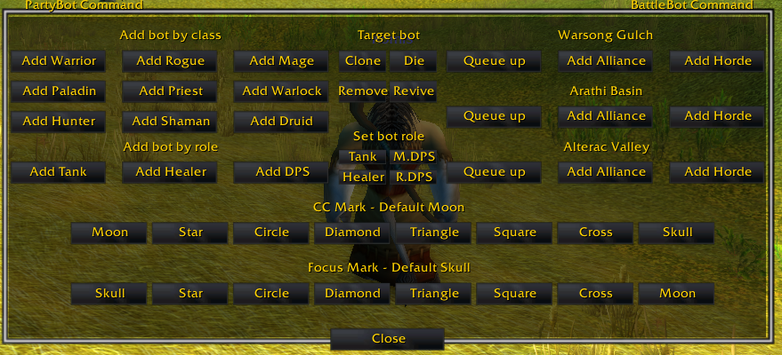

# vbots — bot command panel (v1.1.0)

A small in-game panel that runs the server's bot commands for you, so you
don't have to type them. Open it with `/vbots`, the minimap button, or the
key binding (Esc → Key Bindings → vbots).

You need an admin game account: all bot commands require it.

## What the panel does

- **Party** — copy your character's setup onto a bot (Clone), dismiss bots
  (Remove), kill or revive the selected bot (Die, Revive).
- **Add by class / role** — summon a party bot of one class, or ask for a
  Tank, Healer, or DPS and let the server pick.
- **Set role** — change the selected bot's job (Tank, Healer, melee or
  ranged damage).
- **CC / Focus mark** — put a raid mark on your target telling bots what
  to polymorph (or similar) and what to attack first.
- **Control** — tell bots to follow closely or at a distance, hold
  position, stay quiet unless attacked, or help again.
- **Skill** — set how a bot plays: casual (slower, misses more),
  normal, or sharp (contests every cast).
- **Battle bots** — add Horde or Alliance bots to Warsong, Arathi, or
  Alterac at your level bracket, and set how they play: casual, normal,
  or sharp.

Drag the panel by its background; Esc or Close hides it.

## How to install

- download and rename folder name to vbots
- copy and paste it into yourwowfolder/Interface/Addon
  final path would like yourwowfolder/Interface/Addon/vbots
- enable it from lower left corner the login screen
